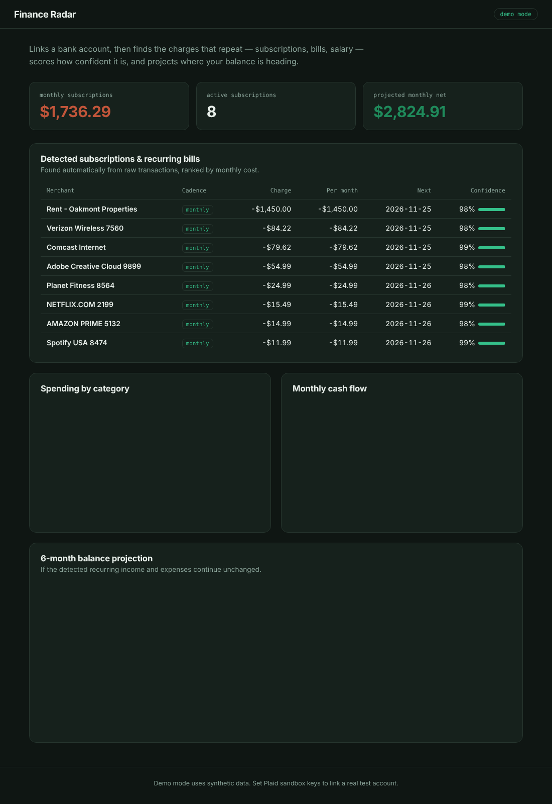
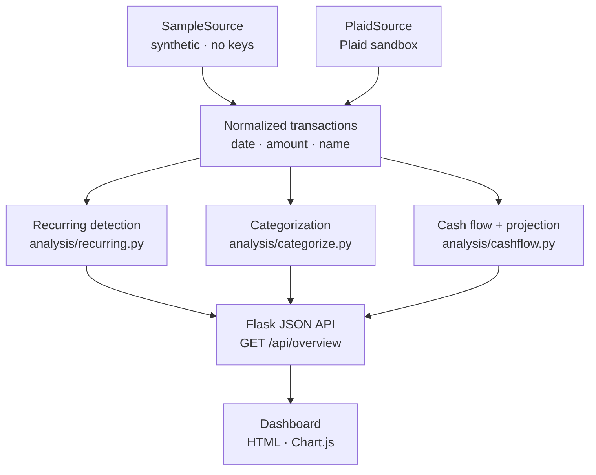
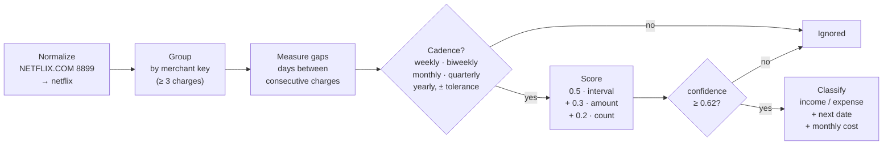

# Finance Radar


[](https://github.com/fadeel7/plaid_finance_radar/actions/workflows/ci.yml)


A personal-finance API that links a bank account, then **automatically detects recurring charges** — subscriptions, bills, salary — from raw transaction data, breaks spending down by category, and projects where your balance is heading.

The interesting part is not fetching transactions. It is the detection: bank descriptions are messy (`NETFLIX.COM 8899`, `Verizon Wireless 7560`), amounts drift by cents, and dates wobble by a day or two, so finding what actually repeats takes real work rather than a string match.

Built with Python and Flask, with bank data from Plaid. Runs in **demo mode with zero setup** (synthetic data, no keys) or against the **Plaid sandbox** with real test accounts.



## What it does

- **Detects recurring charges automatically.** No rules list of known merchants — it finds subscriptions and bills by analyzing the transaction stream itself, scores how confident it is, and predicts the next charge date.
- **Breaks down spending** into categories and shows a monthly cash-flow view.
- **Projects the balance** six months out, built on the recurring income and expenses it detected.
- **Visual dashboard** with a headline subscription figure, a ranked subscriptions table, and charts.

## Architecture

Everything downstream of the data — detection, categorization, cash flow — reads a **normalized transaction list** and never knows where it came from. That is the adapter pattern: adding a third source later (a CSV import, a different aggregator) means writing one class, not touching any analysis code.



**A security decision worth calling out:** the Plaid access token — the credential that can read someone's financial data — is created, stored, and used **only on the server**. The browser only ever holds a short-lived public token during linking, which is exchanged server-side for the access token. The sensitive credential never reaches the client.

## The core: how recurring detection works

This is the part worth reading the code for ([`analysis/recurring.py`](analysis/recurring.py)). Transactions are grouped by a normalized merchant key, and each group with at least three charges is tested for a repeating schedule:



Step by step:

1. **Normalize the description** so the same merchant collapses to one key. `NETFLIX.COM 8899 LOS GATOS` and `Netflix.com` both become `netflix` — digits, store numbers, and noise words are stripped.
2. **Measure the gaps** between charges and test whether their median clusters around a known cadence (weekly → yearly), within a tolerance, because real dates wobble.
3. **Score three independent signals** and combine them into one confidence number:
   - *interval regularity* — how consistent the spacing is (weighted most, `0.5`),
   - *amount consistency* — how stable the charge amount is (`0.3`),
   - *occurrence count* — more repetitions means more certainty (`0.2`, saturating at six).
4. **Keep it only** if a cadence matched and confidence clears `0.62`, then normalize the cost to a monthly figure, predict the next charge, and classify it as income or expense by the sign of the amount.

The result: a clean monthly subscription is caught with high confidence, while irregular one-off spending at the same merchant (a few random coffee runs) is correctly ignored.

## Running it

**Demo mode (no setup):**
```bash
pip install -r requirements.txt
python app.py
```
Open `http://localhost:5000`. It runs on realistic synthetic data immediately.

**Plaid sandbox mode (real test accounts):**
```bash
cp .env.example .env
# add your Plaid sandbox PLAID_CLIENT_ID and PLAID_SECRET from dashboard.plaid.com
python app.py
```
With keys set, the Link endpoints activate and the app pulls real sandbox transactions through the same analysis pipeline.

## Tests

The detection algorithm is unit-tested — clean subscriptions are caught, irregular spending is ignored, noisy merchant names still group, and small amount/date wobble is tolerated.

```bash
pytest
```

## API

| Method | Route                 | Purpose                                                  |
|--------|-----------------------|----------------------------------------------------------|
| GET    | `/api/overview`       | Full analysis: subscriptions, categories, cash flow, projection |
| GET    | `/api/health`         | Status and whether Plaid is configured                   |
| POST   | `/api/link/token`     | Create a Plaid Link token (Plaid mode)                   |
| POST   | `/api/link/exchange`  | Exchange a public token for an access token (Plaid mode) |

## What I'd build next

- Persist linked items and transactions in PostgreSQL (encrypt access tokens at rest).
- Register a Plaid webhook so new transactions update detection automatically instead of on fetch.
- Alert when a new subscription first appears, or when a recurring charge increases.

---

MIT
